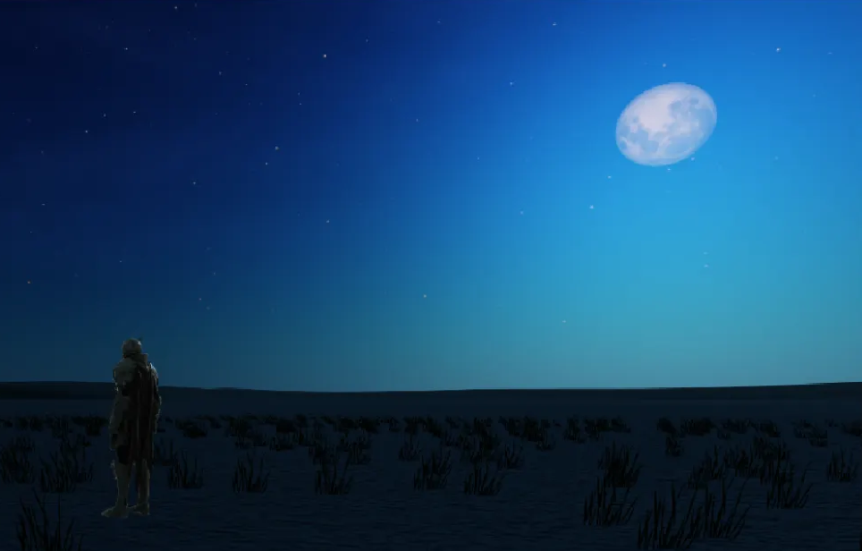

## 소개

> 내일 배움 캠프 Unity 11기의 최종 프로젝트 기간 진행한 팀 프로젝트입니다. '다크 소울' 시리즈, '블러드 본' 등 소울류 장르에서 영감받아 진행한 조선 시대를 배경으로 한 3D RPG 게임을 제작하였습니다.

## 개발 환경

- **OS**: Windows Platform
- **Engine**: Unity 2022.3.62f2

> [!WARNING]
> Copyright Notice
>
> 본 프로젝트는 **학습/데모 목적**으로 제작되었으며, 일부 에셋은 저작권 문제로 인해 저장소에 포함되어 있지 않습니다. 
> 프로젝트를 다운로드하여 Unity에서 실행할 경우 다음과 같은 제한이 있을 수 있습니다.
> 
> - 일부 리소스 누락으로 인한 빌드 오류
> - 특정 기능의 정상 작동 불가
> - 상업적 사용 제한
> 
> **This project is created for educational/demo purposes only. Some assets are not included in the repository due to copyright restrictions.**

## 팀원

